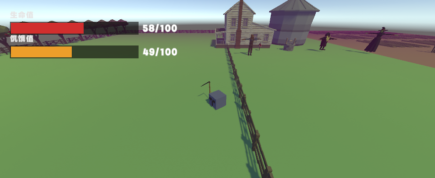

# 动物农场RPG

一个基于 Unity 2023.1.22f1 的单场景第三人称动作 RPG 原型。玩家可以探索农场、采集与整理背包、管理生命和饥饿值，切换镰刀与投枪战斗，并通过 NPC 提交物品完成任务。项目重点不是堆叠内容量，而是将移动、战斗、物品、任务和 UI 串成一个可完整游玩的小型循环。



## 玩法循环

1. 与 NPC 对话并接受任务。
2. 在场景中移动、攻击敌人并拾取掉落物。
3. 在背包中查看物品，装备武器或使用消耗品。
4. 收集任务所需材料并提交，获得奖励。
5. 通过战斗获取经验并提升等级；死亡后可重新开始。

## 背包与物品系统

物品系统采用数据、运行状态和 UI 分离的结构：

| 层次 | 主要脚本 | 职责 |
| --- | --- | --- |
| 数据层 | `ItemSO`、`ItemDBSO` | 配置物品类型、描述、图标、预制体、属性加成，并维护可掉落物品列表 |
| 状态层 | `InventoryManager` | 保存背包中的物品引用，负责添加、计数、单个移除和批量扣除 |
| 展示层 | `InventoryUI`、`ItemUI`、`ItemDetailUI` | 生成物品槽、显示物品详情与属性，并根据类型决定是否显示使用按钮 |
| 使用入口 | `Player` | 根据物品类型装备武器，或将消耗品交给角色属性组件处理 |

物品类型分为武器、消耗品和材料。点击背包物品后会打开详情面板；武器和消耗品可以点击使用，材料只参与任务提交，不显示使用按钮。

使用物品时，UI 删除对应物品槽，`InventoryManager` 同步移除物品引用，然后由 `Player.UseItem` 分发效果：

- 武器会销毁当前手持的武器实例，并在角色对应挂点加载新的武器预制体。
- 消耗品会遍历 `ItemSO` 中配置的属性列表，回复生命值或饥饿值，并触发 HUD 更新事件。
- 任务提交会先检查数量是否满足，再通过 `RemoveItems` 一次性扣除物品和对应 UI 槽，避免任务已完成但背包仍残留物品。

背包 UI 通过预制体生成物品槽，支持滚动浏览和详情查看。批量删除 UI 槽时会先隐藏对象再调用 `Destroy`，避免 Unity 延迟销毁导致同一物品被重复匹配。当前物品以 `ItemSO` 引用逐个保存，尚未实现数量堆叠、排序和持久化。

## 战斗与打击反馈

战斗系统使用 `Weapon` 基类统一攻击入口：

- 镰刀通过动画触发器和武器碰撞体进行近战判定。
- 投枪在手中保持运动学状态，攻击时解除父节点并转为受重力影响的物理投掷物，同时忽略射手自身碰撞体，避免刚出手就被玩家挡住。
- 投枪碰撞后停止物理运动、关闭碰撞并延迟销毁，经过装填间隔后再生成下一发。

敌人受到攻击时，`Enemy.TakeDamage` 会串联以下反馈：

| 阶段 | 实现 |
| --- | --- |
| 数值结算 | 扣除敌人生命值，更新世界空间血条 |
| 动画与声音 | 触发受击动画并播放命中音效 |
| 视觉强化 | 材质 Emission 闪白、生成命中粒子和面向相机的伤害数字 |
| 空间反馈 | 根据玩家方向对敌人执行短距离击退 |
| 节奏反馈 | 将 `Time.timeScale` 短暂降至 `0.05`，形成约 `0.06` 秒命中停顿 |

伤害数字会随机偏移、上浮并逐渐淡出；敌人血条由代码生成两块面向相机的 Quad，在玩家靠近或敌人受伤后显示。攻击范围则通过程序生成的虚线圆形贴图表示，半径与敌人实际伤害判定范围保持一致。

玩家受到攻击时也有独立反馈：生命 HUD 更新、受伤音效、角色闪白、红色伤害数字和相机震动。敌人的攻击带有前摇，前摇结束后会再次检查双方距离，只有仍处于攻击范围时才结算伤害。

命中停顿使用真实时间等待，并在结束后根据游戏是否暂停恢复 `0` 或 `1` 的时间倍率；场景重载和暂停系统也会重置相关静态状态，避免时间缩放残留。

## 任务与角色成长

任务使用 `GameTaskSO` 作为配置资产，并通过 `Waiting / Executing / Completed / End` 状态切换对话和提交逻辑。任务可以配置开始奖励、完成奖励及多项物品需求。

角色生命、饥饿值、经验和等级集中在 `PlayerProperty`。生命和饥饿变化通过事件驱动 HUD 更新；饥饿值每秒下降，耗尽后改为持续损失生命；敌人死亡事件会提供经验，达到阈值后提升等级。

## 技术难点

1. **相机相对移动与 NavMesh 协同**  
   移动方向由相机水平朝向计算，再交给 `NavMeshAgent` 执行；针对 `NavMeshAgent` 不自动避让敌人的问题，使用非分配球形检测和 `Physics.ComputePenetration` 在 `LateUpdate` 中做水平位置修正。

2. **可扩展的敌人行为与战斗节奏**  
   使用 `Normal / Fighting / Moving / Resting` 状态组织巡逻、索敌和战斗逻辑；攻击动画播放前摇，前摇结束后再次检查距离，避免玩家离开范围后仍受到伤害。

3. **背包数据与 UI 的一致性**  
   添加、计数、单个使用和任务批量扣除都需要同时维护数据列表与 UI 槽；批量扣除前先校验数量，UI 删除时处理 Unity 延迟销毁带来的重复匹配问题。

4. **多武器抽象与投掷物生命周期**  
   通过 `Weapon` 基类和派生类统一攻击入口。投枪需要正确处理持握、解除父节点、切换刚体状态、忽略射手碰撞、命中冻结、超时清理与重新装填。

5. **打击反馈的时序一致性**  
   伤害、动画、音效、粒子、伤害数字、击退和时间缩放可能在同一帧触发。命中停顿使用真实时间计时，并与暂停、死亡和场景重载状态协同，避免时间倍率或静态标记残留。

6. **数据驱动配置与游戏流程控制**  
   物品、物品数据库和任务使用 ScriptableObject，将配置从业务代码中分离；主菜单、暂停、死亡、重开等流程集中由 `GameFlowManager` 管理，并统一屏蔽对话、背包和角色面板打开时的游戏输入。

## 运行方式

1. 使用 Unity Hub 以 **Unity 2023.1.22f1** 打开项目根目录。
2. 打开 `Assets/Scenes/01-GameScene.unity`。
3. 点击 Play。首次打开需要联网恢复 Package Manager 依赖。

## 操作

| 操作 | 按键 |
| --- | --- |
| 移动 | `WASD` |
| 旋转视角 | 按住鼠标右键拖动 |
| 交互 / 攻击 | 鼠标左键 |
| 切换镰刀 / 投枪 | `1` / `2` |
| 打开背包 | `B` |
| 查看角色属性 | `E` |
| 暂停 | `Esc` |

## 代码结构

```text
Assets/
├─ Scenes/        主场景
├─ Scripts/
│  ├─ Player/     移动、攻击与角色属性
│  ├─ Enemy/      AI、血条、范围提示与刷怪
│  ├─ Weapon/     镰刀、投枪与投掷物
│  ├─ Interactable/ 拾取、NPC 与任务
│  ├─ Manager/    游戏流程、背包、物品库与事件
│  ├─ SO/         物品数据定义
│  └─ UI/         战斗 HUD、背包、对话与菜单
├─ DataSO/        ScriptableObject 配置
├─ Prefabs/       角色、敌人、武器与物品预制体
└─ Screenshots/   开发过程截图
```

当前版本定位为可玩原型，不包含存档、联网和移动端适配。背包暂不支持数量堆叠、排序和容量限制；速度与攻击属性已经能够配置和显示，但尚未完整接入移动速度和武器伤害计算。第三方美术及音频资源仅用于 Demo 展示。
